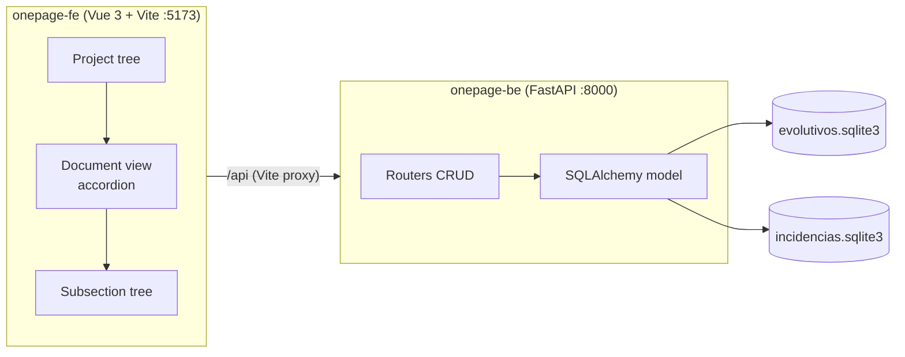

# OnePage

Application for the management of small personal projects, with two work scopes:
**evolutivos** and **incidencias**. Each document reproduces, field by field, the markdown
templates from the [docs](docs) folder, but stored and edited in a single web page.

> 🌐 **Languages**: English (this version) · [Español](README.md)

---

## Index

1. [Functional definition](#functional-definition)
2. [Architecture](#architecture)
3. [Data model](#data-model)
4. [Getting started](#getting-started)
5. [User manual](#user-manual)
6. [Developer manual](#developer-manual)
7. [API reference](#api-reference)

---

## Functional definition

### Objective

Replace the manual maintenance of markdown documents (one file per evolutivo or incidencia) with
an application that:

- structures the information in a database,
- allows editing it field by field without losing the template format,
- and facilitates navigation between projects, documents and sections.

### Scope

| Scope | Covered |
| --- | --- |
| Projects | Create, edit, delete and group documents |
| Evolutivos | Full cycle: requirement, analysis (including prior research), development, tests, DoD, deployment, meetings and follow-up |
| Incidencias | Full cycle: problem, analysis (including prior research), development, tests (including non-regression), DoD, deployment, meetings and follow-up |
| Markdown | Editing texts with Markdown preview through the field button |
| Traceability | Requirement / criterion / task / test / change matrix |
| Planning | Estimated, actual, dates, blockers and states |

### Out of scope

- Authentication and multiuser management.
- Automatic integration with Jira, Bitbucket or Bamboo (identifiers are registered as text).
- Import/export of the original markdown files.

### State convention

The template convention is kept:

- `Borrador` → `En análisis` → `En desarrollo` → `En pruebas` → `Listo para desplegar` → `Cerrado`.
- A task `Bloqueada`, a test case `BLOQUEADA` or a coverage `Bloqueada` prevents advancing to the
  next state until it is resolved or approved.

---

## Architecture

```
onepage/
├── Makefile          Maintenance commands (build / start / stop)
├── docs/             Markdown source templates
├── onepage-be/       Backend: Python + FastAPI + SQLAlchemy + SQLite
│   └── src/onepage_be/
│       ├── config.py        DB paths, ports and CORS
│       ├── database.py      Two engines and two declarative bases
│       ├── models/          ORM model (common mixins + one module per DB)
│       ├── schemas.py       Automatic Pydantic schema generation
│       ├── crud.py          Generic CRUD operations
│       ├── sistema.py       Export / import of databases
│       ├── routers/         Router factory + concrete routers
│       └── main.py          FastAPI application
└── onepage-fe/       Frontend: Vue 3 + Vite
    └── src/
        ├── api.js           HTTP client
        ├── schema.js        Declarative schema of document sections
        ├── toc.js           Navigation index construction
        ├── store/acordeon.js Global section expansion state
        └── components/      Trees, accordion and editors
```

### Diagram



### Design decisions

- **Two independent databases**, one per domain, as required. Projects are replicated in both with
  the same identifier (UUID) so each database is self-contained; creating, updating or deleting a
  project propagates to both.
- **Shared declarative model**: common fields live in `models/mixins.py`; each database instantiates
  its own tables.
- **Generated schemas and routers**: `schemas.build_schemas` derives Pydantic models from SQLAlchemy
  columns and `routers/factory.py` generates the CRUD for each section, avoiding repeated code for
  the more than 20 collections of each document.
- **Schema-driven frontend**: `src/schema.js` describes sections, fields and tables. Adding a
  sub-section to the UI means adding an entry to that file.

---

## Data model

Extracted from [docs/evolutivo-01.md](docs/evolutivo-01.md) and [docs/incidencia-01.md](docs/incidencia-01.md).

### Common to both databases

| Entity | Description |
| --- | --- |
| `proyectos` | Document container (id UUID, name, description, status, owner) |
| `criterios_aceptacion` | Acceptance criteria `CA-XX` |
| `repositorios` | Name, subaccount and space |
| `tareas` | `TAR-XX`, description, design, dependencies, problems and status |
| `tareas_desarrolladas` | Implemented tasks, activities, root cause (if any) and status |
| `cambios_desarrollo` | Objects changed during development |
| `recursos_tarea` | Task resources (database or service) |
| `actividades_tarea` | Task activities checklist |
| `cambios` | Changed objects: name, location, repository, branch and commit |
| `casos_prueba` | `PRU-XX`, preconditions, data, steps, expected result and status |
| `ejecuciones_prueba` | Date, version, environment, owner, result, incident and evidence |
| `definition_of_done` | Closure checklist |
| `despliegues` | Version, environment, date-time, pipeline, validation and rollback plan |
| `bases_datos_afectadas` | Repository, DB, table and fields |
| `reuniones` / `acciones_reunion` | Meeting minutes and actions with owner and target date |
| `planificacion` | Estimated, actual, start, end, blockers and status |
| `trazabilidad` | Coverage matrix |
| `seguimientos` / `tareas_seguimiento` / `actividades_seguimiento` | Daily work parts |

### Specific to evolutivos (`evolutivos.sqlite3`)

- `evolutivos`: header (code, title, status, owner, priority, version, target date, commits,
  deployments, incidents, SM300 reference) and narrative blocks (summary, requirement description,
  objective, scope, out of scope, assumptions, dependencies, risks, pending decisions, planned
  tasks, solution, test data, affected modules, data migration).

### Specific to incidencias (`incidencias.sqlite3`)

- `incidencias`: adds severity, affected version, environment and detection date, Jira issue,
  problem description, impact, reproduction steps, current and expected behavior, correction scope,
  initial evidence, root cause and regression verification.

---

## Getting started

### Prerequisites

- Python ≥ 3.12 and [uv](https://docs.astral.sh/uv/)
- Node.js ≥ 18 and npm
- GNU Make (on Windows, for example, the one included with Git for Windows or Chocolatey)

### Makefile commands

| Command | Action |
| --- | --- |
| `make build` | `uv sync` in the backend + `npm install` and `npm run build` in the frontend |
| `make start` | Start backend and frontend in background |
| `make start_be` | Only backend (http://127.0.0.1:8000) |
| `make start_fe` | Only frontend (http://127.0.0.1:5173) |
| `make stop` | Stop both |
| `make stop_be` / `make stop_fe` | Stop one of them |
| `make status` | Process status |
| `make restart` | `stop` + `start` |
| `make clean` | Remove `dist/` and PID files |

The PID files are saved in `.run/`. The databases are created automatically in
`onepage-be/data/` the first time the backend starts.

Optional variables: `make start BE_PORT=8100 FE_PORT=5200`.

---

## User manual

### Screen layout

| Zone | Content |
| --- | --- |
| Left | Navigation tree: project → *Evolutivos* / *Incidencias* folder → documents |
| Center | Document in markdown format, with expandable sections and subsections (accordion) |
| Right | Index of the current page, also as a tree, synced with the accordion |

### Workflow

1. **Create a project**: `+` button in the left tree header.
2. **Create a document**: `+` button next to *Evolutivos* or *Incidencias* of the project.
3. **Edit**: opens the document and expands the section. Changes are saved when leaving the field
   (`Tab`, click outside or `Enter` in single-line fields); dropdowns and checkboxes save instantly.
4. **Add rows**: each table has `+ Add row`; each checklist has `+ Add item`; tasks, test cases,
   meetings and daily parts have their own `+` button in the section header.
5. **Delete**: the `✕` of each row, or the *Delete* button of the entity or document.
6. **Navigate**: use the right index to jump to any subsection; the accordion opens automatically.
   The *Expand all* / *Collapse all* buttons act on the whole document.
7. **Filter**: the left tree searcher filters by title or document code.
8. **Search anywhere**: the `🔍` button in the left tree header opens the global search area and
   results. It searches any text in titles, narratives, tables, tasks, requirements, meeting notes and
   daily parts, with a direct jump to the corresponding section.
9. **Export to PDF**: the `📄 Export to PDF` button in the document header formats the whole
   evolutivo or incidencia (expanding all sections, rendering all Markdown content with clean vector
   typography, hiding editing controls and adjusting page breaks).

### Project view

When selecting the project node, its file (ficha), the list of evolutivos and incidencias and a
summary of the number of documents per status are shown.

### Database configuration

The `⚙️` icon in the left panel, next to the theme selector, opens the **Settings** view, which for
now contains the **database** section:

- **Export databases**: downloads all databases available in the backend (`evolutivos.sqlite3`,
  `incidencias.sqlite3`, ...).
- **Import**: choose the database (selector) and upload the `.sqlite3` file to restore it.

After exporting, the view shows a notification with the result and where the downloaded files were
saved.

---

## Developer manual

### Development environment

```powershell
make build          # install dependencies
make start          # backend + frontend with Vite reload
```

Interactive API documentation: <http://127.0.0.1:8000/docs>.

### Backend

- `models/mixins.py` contains the reusable column groups.
- To **add a field** to a document: add it to the corresponding model (`models/evolutivo.py` or
  `models/incidencia.py`) and to the frontend schema (`src/schema.js`). The Pydantic schemas and the
  routes are generated automatically.
- To **add a collection**: create the ORM class and register a `Child(...)` in
  `routers/evolutivos.py` or `routers/incidencias.py`. That generates the five CRUD routes.
- The SQLite schema is created with `create_all` on startup; there are no migrations. If you change
  existing columns, delete `onepage-be/data/*.sqlite3` or apply the `ALTER TABLE` by hand.
- The `parent_path` routes of a `Child` allow nesting collections (for example, `cambios` hangs from
  `tareas`).

### Frontend

- `src/schema.js` is the single source of truth of the UI. Accepted node types:
  - `texto`: free text block associated to a document field.
  - `tabla`: editable in-line collection, with configurable columns.
  - `checklist`: checklist with checkbox and description.
  - `entidades`: collection where each element is an accordion with file, texts and subcollections.
- Text blocks are edited with `MarkdownField.vue`; the button in its corner toggles between editing and
  Markdown preview.
- Controls available in `EntradaCampo.vue`: `texto`, `area`, `select`, `numero` and `check`.
- The expansion state lives in `src/store/acordeon.js` and is shared between the document and the right
  index; keys have path form (`doc/analisis/tareas/3/cambios`).
- After any mutation the whole document is reloaded (`GET /{tipo}/{id}/full`), keeping the view always
  consistent with the database.

### Visual style

`src/styles/markdown.css` reproduces the typography, tables, quotes and separators of a rendered
markdown page, so the application feels familiar with the original documents.

---

## API reference

Common prefix: `/api`.

| Method and route | Description |
| --- | --- |
| `GET /salud` | Health check |
| `GET /sistema/bases` | List of available databases |
| `GET /sistema/bases/{nombre}/descargar` | Download a SQLite database |
| `POST /sistema/bases/{nombre}/importar` | Import / restore a database |
| `GET /buscar` | Global text search in projects, documents and subcollections (`?q=&tipo=&limite=`) |
| `GET /arbol` | Projects with their evolutivos and incidencias (left tree) |
| `GET/POST /proyectos` | List and create (replicated in both bases) |
| `GET/PUT/DELETE /proyectos/{id}` | Get, update and delete |
| `GET/POST /evolutivos` | List (filter `?proyecto_id=`) and create |
| `GET/PUT/DELETE /evolutivos/{id}` | Get, update and delete |
| `GET /evolutivos/{id}/full` | Full document with all nested sections |
| `GET/POST /evolutivos/{id}/{sección}` | List and create of a section |
| `GET/PUT/DELETE /evolutivos/{sección}/item/{item_id}` | Get, update and delete of a record |
| `GET/POST /evolutivos/tareas/{tarea_id}/{subsección}` | Subcollections (`recursos`, `actividades`, `cambios`) |
| `…/incidencias/…` | Same routes for incidencias |

Available sections: `grupos-requisito`, `requisitos` (evolutivos only), `criterios`,
`repositorios`, `tareas`, `casos-prueba`, `definition-of-done`, `registros-despliegue`,
`bases-datos`, `reuniones`, `planificacion`, `trazabilidad` and `seguimientos`.

Subcollections: `tareas/{id}/{recursos|actividades|cambios}`,
`casos-prueba/{id}/ejecuciones`, `reuniones/{id}/acciones`,
`seguimientos/{id}/tareas-seguimiento` and `tareas-seguimiento/{id}/actividades-seguimiento`.
