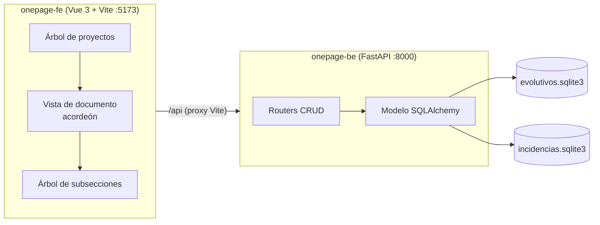

# OnePage

Aplicación para la gestión de proyectos pequeños y personales, con dos ámbitos de trabajo:
**evolutivos** e **incidencias**. Cada documento reproduce, campo a campo, las plantillas
markdown de la carpeta [docs](docs), pero almacenadas y editables en una única página web.

> 🌐 **Languages**: Español (esta versión) · [English](README.en.md)

---

## Índice

1. [Definición funcional](#definición-funcional)
2. [Arquitectura](#arquitectura)
3. [Modelo de datos](#modelo-de-datos)
4. [Puesta en marcha](#puesta-en-marcha)
5. [Manual de usuario](#manual-de-usuario)
6. [Manual de desarrollador](#manual-de-desarrollador)
7. [Referencia de la API](#referencia-de-la-api)

---

## Definición funcional

### Objetivo

Sustituir el mantenimiento manual de documentos markdown (un fichero por evolutivo o
incidencia) por una aplicación que:

- estructure la información en base de datos,
- permita editarla campo a campo sin perder el formato de la plantilla,
- y facilite la navegación entre proyectos, documentos y secciones.

### Alcance

| Ámbito | Cubierto |
| --- | --- |
| Proyectos | Alta, edición, borrado y agrupación de documentos |
| Evolutivos | Ciclo completo: requerimiento, análisis (incluida investigación previa), desarrollo, pruebas, DoD, despliegue, reuniones y seguimiento |
| Incidencias | Ciclo completo: problema, análisis (incluida investigación previa), desarrollo, pruebas (incluida no regresión), DoD, despliegue, reuniones y seguimiento |
| Markdown | Edición de los textos con previsualización Markdown mediante el botón del campo |
| Trazabilidad | Matriz requisito / criterio / tarea / prueba / cambios |
| Planificación | Estimado, real, fechas, bloqueos y estados |

### Fuera de alcance

- Autenticación y gestión multiusuario.
- Integración automática con Jira, Bitbucket o Bamboo (los identificadores se registran como texto).
- Importación/exportación de los ficheros markdown originales.

### Convención de estados

Se conserva la convención de las plantillas:

- `Borrador` → `En análisis` → `En desarrollo` → `En pruebas` → `Listo para desplegar` → `Cerrado`.
- Una tarea `Bloqueada`, un caso de prueba `BLOQUEADA` o una cobertura `Bloqueada` impide avanzar
  al siguiente estado hasta que se resuelva o se apruebe la excepción.

---

## Arquitectura

```
onepage/
├── Makefile          Comandos de mantenimiento (build / start / stop)
├── docs/             Plantillas markdown origen del modelo
├── onepage-be/       Backend: Python + FastAPI + SQLAlchemy + SQLite
│   └── src/onepage_be/
│       ├── config.py        Rutas de las BBDD, puertos y CORS
│       ├── database.py      Dos motores y dos bases declarativas
│       ├── models/          Modelo ORM (mixins comunes + un módulo por BBDD)
│       ├── schemas.py       Generación automática de esquemas Pydantic
│       ├── crud.py          Operaciones CRUD genéricas
│       ├── sistema.py       Exportación / importación de bases
│       ├── routers/         Fábrica de routers + routers concretos
│       └── main.py          Aplicación FastAPI
└── onepage-fe/       Frontend: Vue 3 + Vite
    └── src/
        ├── api.js           Cliente HTTP
        ├── schema.js        Esquema declarativo de secciones de cada documento
        ├── toc.js           Construcción del índice de navegación
        ├── store/acordeon.js Estado global de apertura de secciones
        └── components/      Árboles, acordeón y editores
```

### Diagrama



### Decisiones de diseño

- **Dos bases de datos independientes**, una por dominio, tal y como se pide en el requisito.
  Los proyectos se replican en ambas con el mismo identificador (UUID) para que cada base sea
  autocontenida; el alta, la modificación y el borrado de un proyecto se propagan a las dos.
- **Modelo declarativo compartido**: los campos comunes a ambos dominios viven en
  `models/mixins.py`; cada base de datos instancia sus propias tablas.
- **Esquemas y routers generados**: `schemas.build_schemas` deriva los modelos Pydantic desde las
  columnas SQLAlchemy y `routers/factory.py` genera el CRUD de cada sección, evitando código
  repetido para las más de 20 colecciones de cada documento.
- **Frontend dirigido por esquema**: `src/schema.js` describe las secciones, sus campos y sus
  tablas. Añadir una subsección a la interfaz es añadir una entrada a ese fichero.

---

## Modelo de datos

Extraído de [docs/evolutivo-01.md](docs/evolutivo-01.md) y [docs/incidencia-01.md](docs/incidencia-01.md).

### Común a ambas bases

| Entidad | Descripción |
| --- | --- |
| `proyectos` | Contenedor de documentos (id UUID, nombre, descripción, estado, responsable) |
| `criterios_aceptacion` | Criterios `CA-XX` |
| `repositorios` | Nombre, subaccount y space |
| `tareas` | `TAR-XX`, descripción, diseño, dependencias, problemas y estado |
| `tareas_desarrolladas` | Tareas implementadas, actividades, causa raíz (si aplica) y estado |
| `cambios_desarrollo` | Objetos modificados durante el desarrollo |
| `recursos_tarea` | Recursos dependientes (base de datos o servicio) |
| `actividades_tarea` | Checklist de actividades de la tarea |
| `cambios` | Objetos modificados: nombre, ubicación, repositorio, rama y commit |
| `casos_prueba` | `PRU-XX`, precondiciones, datos, pasos, resultado esperado y estado |
| `ejecuciones_prueba` | Fecha, versión, entorno, responsable, resultado, incidencia y evidencias |
| `definition_of_done` | Checklist de cierre |
| `despliegues` | Versión, entorno, fecha-hora, pipeline, validación y plan de reversión |
| `bases_datos_afectadas` | Repositorio, BBDD, tabla y campos |
| `reuniones` / `acciones_reunion` | Acta y acciones con responsable y fecha objetivo |
| `planificacion` | Estimado, real, inicio, fin, bloqueos y estado |
| `trazabilidad` | Matriz de cobertura |
| `seguimientos` / `tareas_seguimiento` / `actividades_seguimiento` | Partes diarios de trabajo |

### Específico de evolutivos (`evolutivos.sqlite3`)

- `evolutivos`: cabecera (código, título, estado, responsable, prioridad, versión, fecha objetivo,
  commits, despliegues, incidencias, referencia SM300) y bloques narrativos
  (resumen, descripción del requerimiento, objetivo, alcance, fuera de alcance, supuestos,
  dependencias, riesgos, decisiones pendientes, tareas planificadas, solución, datos de pruebas,
  módulos afectados, migración de datos).
- `grupos_requisito` y `requisitos` (`REQ-XX`), no presentes en incidencias.
- Las tareas y los casos de prueba referencian el requisito.

### Específico de incidencias (`incidencias.sqlite3`)

- `incidencias`: añade severidad, versión afectada, entorno y fecha de detección, incidencia Jira,
  descripción del problema, impacto, pasos para reproducir, comportamiento actual y esperado,
  alcance de la corrección, evidencias iniciales, causa raíz y verificación de no regresión.
- Las tareas y los casos de prueba referencian el criterio de aceptación.
- `casos_prueba` incluye `es_regresion`, `datos_usados` y `pasos_dados`.

---

## Puesta en marcha

### Requisitos previos

- Python ≥ 3.12 y [uv](https://docs.astral.sh/uv/)
- Node.js ≥ 18 y npm
- GNU Make (en Windows, por ejemplo, el que incluye Git for Windows o Chocolatey)

### Comandos del Makefile

| Comando | Acción |
| --- | --- |
| `make build` | `uv sync` en el backend + `npm install` y `npm run build` en el frontend |
| `make start` | Arranca backend y frontend en segundo plano |
| `make start_be` | Solo backend (http://127.0.0.1:8000) |
| `make start_fe` | Solo frontend (http://127.0.0.1:5173) |
| `make stop` | Detiene ambos |
| `make stop_be` / `make stop_fe` | Detiene uno de ellos |
| `make status` | Estado de los procesos |
| `make restart` | `stop` + `start` |
| `make clean` | Borra `dist/` y los ficheros de PID |

Los PID se guardan en `.run/`. Las bases de datos se crean solas en `onepage-be/data/`
la primera vez que arranca el backend.

Variables opcionales: `make start BE_PORT=8100 FE_PORT=5200`.

---

## Manual de usuario

### Disposición de la pantalla

| Zona | Contenido |
| --- | --- |
| Izquierda | Árbol de navegación: proyecto → carpeta *Evolutivos* / *Incidencias* → documentos |
| Centro | Documento en formato markdown, con secciones y subsecciones plegables (acordeón) |
| Derecha | Índice de la página actual, también en árbol, sincronizado con el acordeón |

### Flujo de trabajo

1. **Crear un proyecto**: botón `+` de la cabecera del árbol izquierdo.
2. **Crear un documento**: botón `+` junto a *Evolutivos* o *Incidencias* del proyecto.
3. **Editar**: abre el documento y despliega la sección. Los cambios se guardan al salir del
   campo (`Tab`, clic fuera o `Enter` en los campos de una línea); los desplegables y las casillas
   se guardan al instante.
4. **Añadir filas**: cada tabla dispone de `+ Añadir fila`; cada lista de comprobación, de
   `+ Añadir elemento`; las tareas, casos, reuniones y partes de seguimiento tienen su propio
   botón `+` en la cabecera de la sección.
5. **Eliminar**: la `✕` de cada fila, o el botón *Eliminar* de la entidad o del documento.
6. **Navegar**: usa el índice derecho para saltar a cualquier subsección; el acordeón se abre
   automáticamente. Los botones *Expandir todo* / *Contraer todo* actúan sobre todo el documento.
7. **Filtrar**: el buscador del árbol izquierdo filtra por título o código de documento.
8. **Buscar en cualquier parte**: el botón `🔍` de la cabecera del árbol abre la zona de búsqueda global y resultados. Busca cualquier texto en títulos, narrativas, tablas, tareas, requisitos, notas de reuniones y partes diarios, con salto directo a la sección correspondiente.
9. **Exportar a PDF**: el botón `📄 Exportar a PDF` de la cabecera del documento formatea el evolutivo o incidencia completo (desplegando todas las secciones, renderizando todo el contenido Markdown a tipografía vectorial limpia, ocultando controles de edición y ajustando saltos de página).

### Vista de proyecto

Al seleccionar el nodo del proyecto se muestra su ficha, el listado de evolutivos e incidencias
y un resumen del número de documentos por estado.

### Configuración y bases de datos

El icono `⚙️` del panel izquierdo, junto al selector de tema, abre la vista de
**Configuración**, que por ahora concentra el apartado de **bases de datos**:

- **Exportar bases de datos**: descarga todas las bases disponibles del backend.
- **Importar**: elige la base (selector) y sube el fichero `.sqlite3` para restaurarla.

Tras una exportación, la vista muestra una notificación con el resultado y la ubicación de los
ficheros descargados.

---

## Manual de desarrollador

### Entorno de desarrollo

```powershell
make build          # instala dependencias
make start          # backend + frontend con recarga de Vite
```

Documentación interactiva de la API: <http://127.0.0.1:8000/docs>.

### Backend

- `models/mixins.py` contiene los grupos de columnas reutilizables.
- Para **añadir un campo** a un documento: añádelo al modelo correspondiente
  (`models/evolutivo.py` o `models/incidencia.py`) y al esquema del frontend (`src/schema.js`).
  Los esquemas Pydantic y las rutas se regeneran automáticamente.
- Para **añadir una colección**: crea la clase ORM y registra un `Child(...)` en
  `routers/evolutivos.py` o `routers/incidencias.py`. Eso genera las cinco rutas CRUD.
- El esquema SQLite se crea con `create_all` al arrancar; no hay migraciones. Si cambias columnas
  existentes, borra `onepage-be/data/*.sqlite3` o aplica el `ALTER TABLE` a mano.
- Las rutas `parent_path` de un `Child` permiten anidar colecciones (por ejemplo, `cambios`
  cuelga de `tareas`).

### Frontend

- `src/schema.js` es la única fuente de verdad de la interfaz. Tipos de nodo admitidos:
  - `texto`: bloque de texto libre asociado a un campo del documento.
  - `tabla`: colección editable en línea, con columnas configurables.
  - `checklist`: lista de comprobación con casilla y descripción.
  - `entidades`: colección donde cada elemento es un acordeón con ficha, textos y subcolecciones.
- Los bloques de texto se editan con `MarkdownField.vue`; el botón situado en su esquina alterna
  entre edición y previsualización Markdown.
- Controles disponibles en `EntradaCampo.vue`: `texto`, `area`, `select`, `numero` y `check`.
- El estado de apertura vive en `src/store/acordeon.js` y se comparte entre el documento y el
  índice derecho; las claves tienen forma de ruta (`doc/analisis/tareas/3/cambios`).
- Tras cualquier mutación se recarga el documento completo (`GET /{tipo}/{id}/full`), lo que
  mantiene la vista siempre consistente con la base de datos.

### Estilo visual

`src/styles/markdown.css` reproduce la tipografía, tablas, citas y separadores de una página
markdown renderizada, para que la aplicación resulte familiar frente a los documentos originales.

---

## Referencia de la API

Prefijo común: `/api`.

| Método y ruta | Descripción |
| --- | --- |
| `GET /salud` | Comprobación de vida |
| `GET /sistema/bases` | Lista de bases de datos disponibles |
| `GET /sistema/bases/{nombre}/descargar` | Descarga de una base SQLite |
| `POST /sistema/bases/{nombre}/importar` | Importación / restauración de una base |
| `GET /buscar` | Búsqueda global de texto en proyectos, documentos y subcolecciones (`?q=&tipo=&limite=`) |
| `GET /arbol` | Proyectos con sus evolutivos e incidencias (árbol izquierdo) |
| `GET/POST /proyectos` | Listado y alta (replicado en ambas bases) |
| `GET/PUT/DELETE /proyectos/{id}` | Detalle, modificación y baja |
| `GET/POST /evolutivos` | Listado (filtro `?proyecto_id=`) y alta |
| `GET/PUT/DELETE /evolutivos/{id}` | Detalle, modificación y baja |
| `GET /evolutivos/{id}/full` | Documento completo con todas sus secciones anidadas |
| `GET/POST /evolutivos/{id}/{sección}` | Listado y alta de una sección |
| `GET/PUT/DELETE /evolutivos/{sección}/item/{item_id}` | Detalle, modificación y baja de un registro |
| `GET/POST /evolutivos/tareas/{tarea_id}/{subsección}` | Subcolecciones (`recursos`, `actividades`, `cambios`) |
| `…/incidencias/…` | Mismas rutas para incidencias |

Secciones disponibles: `grupos-requisito`, `requisitos` (solo evolutivos), `criterios`,
`repositorios`, `tareas`, `casos-prueba`, `definition-of-done`, `registros-despliegue`,
`bases-datos`, `reuniones`, `planificacion`, `trazabilidad` y `seguimientos`.

Subcolecciones: `tareas/{id}/{recursos|actividades|cambios}`,
`casos-prueba/{id}/ejecuciones`, `reuniones/{id}/acciones`,
`seguimientos/{id}/tareas-seguimiento` y `tareas-seguimiento/{id}/actividades-seguimiento`.
